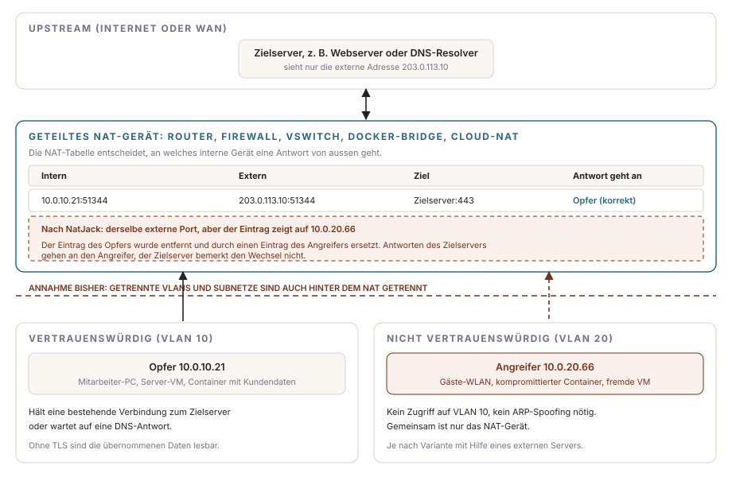
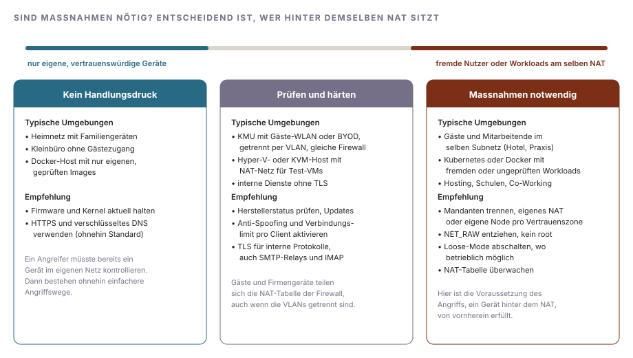
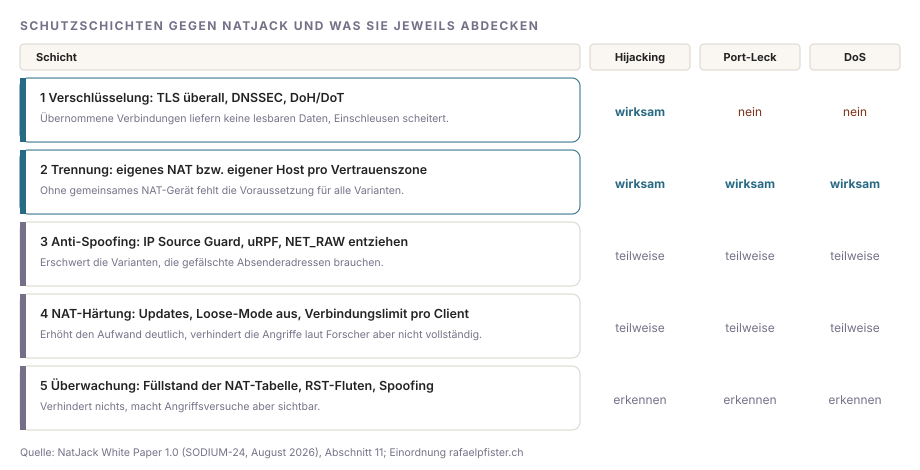

# NatJack: Angriffe auf NAT-Tabellen erklärt, wer betroffen ist und welche Massnahmen nötig sind

NatJack ist eine Angriffsklasse gegen Geräte, die Network Address Translation (NAT) betreiben: Router, Firewalls, Hypervisor-Netze, Container-Bridges und Cloud-NAT-Gateways. Ein Angreifer, der hinter demselben NAT-Gerät sitzt wie sein Opfer, manipuliert dessen NAT-Tabelle so, dass Antworten aus dem Internet nicht mehr beim Opfer, sondern bei ihm ankommen. So lassen sich bestehende TCP-Verbindungen übernehmen, DNS-Antworten abfangen und fälschen oder das NAT-Gerät für alle anderen Nutzer blockieren. Veröffentlicht hat die Forschung Malcolm Stagg (SODIUM-24, LLC) am 6. August 2026 an der Black Hat USA, koordiniert über CERT/CC (VU#268870) mit 13 Herstellern. In 23 getesteten Produkten wurden 95 Einzelbefunde gemeldet; laut Whitepaper war jedes getestete Gerät mit NAT für mindestens einen Teil der Angriffe anfällig.

Kurzfazit: Für ein Heimnetz mit eigenen Geräten besteht kein Handlungsbedarf. Massnahmen sind dort notwendig, wo fremde oder nicht vertrauenswürdige Nutzer und Workloads dasselbe NAT-Gerät nutzen wie Ihre produktiven Systeme: Gäste-WLAN an der Firmenfirewall, Docker- und Kubernetes-Hosts mit fremden Images, Test-VMs im NAT-Netz eines Hyper-V-Hosts, Hosting- und Co-Working-Umgebungen. Die wirksamste Massnahme ist Verschlüsselung (TLS auch intern, abgesichertes DNS), die zweitwirksamste die Trennung der Vertrauenszonen auf eigene NAT-Geräte.

<div class="notfall-hinweis">
<p class="notfall-hinweis__titel">Unterstützung bei der Bewertung</p>
<p>Wenn Sie prüfen möchten, ob Ihre Firewall-, Container- oder Hypervisor-Umgebung betroffen ist, nutzen Sie bitte das <a href="https://adeptio.ch/">Kontaktformular auf adeptio.ch</a>.</p>
</div>

## Was eine NAT-Tabelle tut

Hinter einem NAT-Gerät haben die Geräte private Adressen aus RFC 1918, etwa `10.0.10.21`. Baut ein Gerät eine Verbindung nach aussen auf, ersetzt das NAT-Gerät Absenderadresse und Port durch seine externe Adresse und einen externen Port und merkt sich die Zuordnung in der NAT-Tabelle. Kommt die Antwort des Servers zurück, schlägt das Gerät in der Tabelle nach, an welches interne Gerät sie gehört. Unter Linux erledigt das Netfilter mit seinem Verbindungs-Tracking `conntrack`; die meisten handelsüblichen Router, OpenWRT, Docker und Kubernetes verwenden diesen Code.

Ursprünglich war NAT eine Übergangslösung gegen die Knappheit von IPv4-Adressen und keine Sicherheitsgrenze. In der Praxis ist es jedoch zu einer geworden: Auf Layer 2 trennen VLANs, Port-Isolation, Dynamic ARP Inspection und vSwitch-Isolation die Geräte sauber voneinander, und ARP-Spoofing ist in gepflegten Netzen kaum noch möglich. Auf Layer 3/4 laufen die getrennten Netze jedoch oft wieder im selben NAT-Gerät zusammen. Genau an dieser Stelle setzt NatJack an.



## Wie der Angriff funktioniert

Alle NatJack-Varianten folgen demselben Muster: Der Angreifer bringt das NAT-Gerät dazu, den Tabelleneintrag des Opfers zu entfernen, und legt sofort einen eigenen Eintrag mit denselben externen Parametern an. Das NAT-Gerät leitet die nächste Antwort des Servers dann an den Angreifer weiter. Weder der Server noch das Opfer erhalten dabei eine Fehlermeldung.

Möglich wird das durch Verhaltensweisen, die für ein kooperatives Netz entworfen wurden und dort sinnvoll sind:

- **Loose-Mode:** Netfilter nimmt standardmässig auch TCP-Verbindungen in die Tabelle auf, deren Handshake es nicht gesehen hat. Das soll Verbindungen nach einem Router-Neustart oder Pfadwechsel erhalten, erlaubt aber auch das Anlegen von Einträgen ohne gültigen Verbindungsaufbau.
- **Grosszügige Prüfung von Reset-Paketen:** Das NAT-Gerät prüft Sequenznummern weniger streng als die Endpunkte selbst, damit es keine gültigen Pakete verwirft. Pakete, die ein Endpunkt ignorieren würde, kann das NAT-Gerät noch als Verbindungsende werten.
- **Port Preservation und Endpoint-Independent Mapping:** Netfilter übernimmt nach Möglichkeit den internen Port als externen Port und verwendet eine einmal vergebene Zuordnung für alle Ziele weiter. Aus dem Verhalten bei Portkonflikten lässt sich ableiten, welche Ports andere Geräte gerade verwenden.
- **Endliche Tabelle:** Ist die Tabelle voll, verwirft Netfilter zufällig noch nicht bestätigte Einträge, etwa offene DNS-Anfragen. Bestätigte Verbindungen bleiben bis zu fünf Tage stehen.

Für die meisten Varianten muss der Angreifer Pakete mit gefälschter Absenderadresse senden können. Liegen Angreifer und Opfer im selben Subnetz, genügt ihm dafür ein Gerät oder Container mit Rohsocket-Rechten (`NET_RAW`). Die Upstream-Variante funktioniert auch über Subnetz- und VLAN-Grenzen hinweg; dafür braucht der Angreifer zusätzlich einen eigenen Server im Internet, der Pakete mit gefälschter Absenderadresse verschicken kann. Die Paketsequenzen und den Proof-of-Concept-Code beschreibt das Whitepaper; der angekündigte Technical Report mit Testframework ist noch nicht erschienen.

## Die fünf Schwachstellen im Überblick

Das Whitepaper beschreibt fünf Schwachstellen. Die Bewertungen sind typische Werte; je nach Produkt weichen sie ab.

| Schwachstelle | Auswirkung | CVSS 3.1 (typisch) |
|---|---|---|
| Denial of Service | Der Angreifer füllt die NAT-Tabelle mit bestätigten Einträgen. Kein anderes Gerät kann neue Verbindungen aufbauen, bei Netfilter bis zu fünf Tage oder bis zum Neustart. | 7.4 (High) |
| Offenlegung von Port und IP | Der Angreifer erkennt, dass ein anderes Gerät mit einem bestimmten Server verbunden ist, und ermittelt dessen Port und interne Adresse. Das dient vor allem als Vorstufe für die übrigen Angriffe. | 4.7 (Medium) |
| DNS-Hijacking über UDP | Der Angreifer fängt mit einer gewissen Wahrscheinlichkeit die DNS-Antwort für ein anderes Gerät ab und schickt eine gefälschte Antwort, etwa mit der Adresse eines eigenen Servers. | 10.0 (Critical) |
| TCP-Hijacking (Downstream) | Der Angreifer übernimmt eine bestehende TCP-Verbindung eines Geräts im selben Subnetz, liest die Antworten des Servers und sendet im Namen des Opfers. | 9.6 (Critical) |
| TCP-Hijacking (Upstream) | Wie oben, jedoch über Subnetz- und VLAN-Grenzen hinweg mit Hilfe eines externen Servers des Angreifers. | 10.0 (Critical) |

Betroffen sind alle Protokolle ohne starke Verschlüsselung: HTTP, DNS über UDP, Telnet-basierte Verwaltungsprotokolle sowie Mailprotokolle wie SMTP und IMAP, wenn sie ohne TLS laufen. Bei einer TLS-Verbindung kann der Angreifer die Verbindung zwar unterbrechen, er erhält jedoch keine lesbaren Daten und kann nichts einschleusen. Das Whitepaper weist ausserdem darauf hin, dass Angriffspakete mit reduzierter TTL so verschickt werden können, dass sie das NAT-Gerät erreichen, aber nicht weiter ins Netz gelangen. Das erschwert die Erkennung.

Im Vergleich mit ARP-Spoofing hat NatJack eine ähnliche Wirkung, umgeht jedoch die etablierten Schutzmechanismen auf Layer 2. Frühere Arbeiten von Yang et al. (CVE-2023-30305 bis CVE-2023-30314) zeigten TCP-Hijacking über NAT-Tabellen bei WLAN-Routern mit unsicheren Nicht-Standard-Optionen; NatJack funktioniert in der Standardkonfiguration.

## Wer betroffen ist

Laut Whitepaper sind praktisch alle Linux-basierten Router anfällig, ebenso Systeme mit völlig anderer Codebasis. Die folgende Übersicht fasst den Stand der Patch-Matrix auf natjack.io zusammen (letzte Aktualisierung 19. August 2026).

| Bereich | Produkte | Stand |
|---|---|---|
| Linux / Netfilter | Linux-Kernel, OpenWRT, DD-WRT, fast alle Linux-basierten Router | Teilfix mit CVE-2026-63913 ab Linux 7.1; erhöht den Aufwand, kein vollständiger Schutz. OpenWRT und DD-WRT brauchen die Netfilter-Änderungen. |
| BSD | FreeBSD pf, OpenBSD pf | FreeBSD ab 15.0.0 durch eine Änderung aus OpenBSD stark abgeschwächt, ältere Versionen betroffen. OpenBSD seit 2016 deutlich besser geschützt. |
| Windows | Windows NAT (Hyper-V vSwitch mit NAT) | CVE-2026-56181 (Juli 2026) und CVE-2026-56179 (August 2026), beide als moderat eingestuft. Die Mitigation zu CVE-2026-56179 ist standardmässig deaktiviert und wird per Registry aktiviert. Windows Internet Connection Sharing in Prüfung. |
| Netzwerkgeräte | Cisco Firepower und Meraki, NETGEAR Nighthawk, Google Nest WiFi Pro, SpaceX Starlink, Amazon eero | Je nach Hersteller Teilschutz, Konfigurationsempfehlungen oder kein Update. eero hat eine eigene Mitteilung veröffentlicht. |
| Hotspots | iOS Persönlicher Hotspot, macOS Internetfreigabe, Android-Hotspot | betroffen |
| Virtualisierung und Container | Hyper-V, KVM/QEMU, Apple Virtualization Framework, Docker (Bridge), FreeBSD Jails, GKE, MicroK8s mit Calico oder Flannel, Azure AKS | betroffen; Schutz vor allem über Konfiguration (siehe unten) |
| Cloud | AWS NAT Gateway und NLB, Google Cloud NAT, Cloud Run, Azure Firewall, Azure NAT Gateway, Azure Functions | AWS hat serverseitig gehärtet, Kunden müssen nichts tun. AWS Lambda ist mangels `NET_RAW` geschützt. Für die übrigen Dienste den Stand auf natjack.io prüfen. |

## Sind Massnahmen notwendig?

Entscheidend ist, wer hinter demselben NAT-Gerät sitzt; ob Ihr Router-Modell in der Liste steht, ist zweitrangig. Jede Variante setzt voraus, dass der Angreifer bereits ein Gerät, eine VM oder einen Container hinter dem NAT kontrolliert. Wo das nur eigene, vertrauenswürdige Geräte sind, hätte ein Angreifer mit diesem Zugang ohnehin einfachere Wege. Das Whitepaper hält entsprechend fest, dass die meisten Heimanwender nicht ernsthaft betroffen sind, während die Auswirkungen für Unternehmen und Dienstleister deutlich schwerer wiegen.



In Schweizer KMU ist die mittlere Stufe der häufigste Fall: Das Gäste-WLAN ist per VLAN getrennt, läuft aber über dieselbe Firewall ins Internet wie das Firmennetz. Die VLAN-Trennung verhindert ARP-Spoofing und direkten Zugriff, die NAT-Tabelle teilen sich beide Netze trotzdem. Für die Downstream-Variante bräuchte der Angreifer das gleiche Subnetz wie sein Opfer; die Upstream-Variante funktioniert über die VLAN-Grenze hinweg, ist jedoch aufwendiger und benötigt einen externen Server. Klar notwendig sind Massnahmen, wo Fremde im selben Subnetz sitzen (Hotel-, Praxis- oder Schul-WLAN ohne Client-Isolation) und auf Container- und Kubernetes-Hosts, auf denen Workloads unterschiedlicher Vertrauensstufen laufen. Ein kompromittiertes npm- oder PyPI-Paket in einem Container genügt dort als Ausgangspunkt.

Für Maildienste lohnt sich ein gezielter Blick auf interne Verbindungen ohne TLS: Scanner, Fachanwendungen und Monitoring-Systeme, die über Port 25 unverschlüsselt an einen internen Relay einliefern, sowie IMAP ohne TLS. Wie Sie TLS und Authentisierung am Relay prüfen, beschreibt der Artikel [Mailversand über ein Relay: TLS und Authentisierung prüfen](/blog/mail-relay-tls-authentisierung-pruefen).

## Massnahmen

Die Empfehlungen des Whitepapers lassen sich in fünf Schichten ordnen. Sie unterscheiden sich darin, gegen welche der Schwachstellen sie helfen.



### Verschlüsselung

TLS auf allen Verbindungen, auch zwischen internen Systemen, macht übernommene TCP-Verbindungen wertlos: Der Angreifer kann sie abbrechen, aber weder mitlesen noch Daten einschleusen. Für DNS empfiehlt das Whitepaper DNSSEC gegen gefälschte Antworten sowie DNS over HTTPS oder DNS over TLS gegen das Abfangen. Gegen Port-Offenlegung und Denial of Service hilft Verschlüsselung nicht.

### Trennung der Vertrauenszonen

Betreiben Sie nicht vertrauenswürdige Geräte und Workloads in eigenen Subnetzen und VLANs, mit L3/L4-ACLs, die jeden Zugriff auf vertrauenswürdige Hosts unterbinden. Wirksamer ist ein eigenes NAT-Gerät oder eine eigene externe Adresse pro Vertrauenszone, denn ohne gemeinsame NAT-Tabelle fehlt die Grundlage für alle Varianten. In der Cloud bedeutet das: vertrauenswürdige und fremde Workloads nicht hinter demselben NAT Gateway betreiben und für Serverless-Dienste dedizierte statt geteilter IP-Adressen verwenden. In Kubernetes laufen nicht vertrauenswürdige Pods auf eigenen Nodes.

### Anti-Spoofing

Aktivieren Sie IP Source Guard oder eine vergleichbare Funktion am Switch beziehungsweise Access Point und uRPF (Reverse Path Filtering) am Router, damit Clients nur mit ihrer eigenen Adresse senden können. In Containern verhindert das Entziehen der Capability `NET_RAW`, dass ein kompromittierter Prozess gefälschte Pakete erzeugt. Docker vergibt diese Capability standardmässig.

```bash
docker run --cap-drop=NET_RAW --user 1000:1000 example/app:1.4
```

<details class="options-details">
<summary>Optionen erklärt</summary>

| Option | Wirkung |
|---|---|
| `run` | Startet einen neuen Container aus einem Image |
| `--cap-drop=NET_RAW` | Entzieht dem Container das Recht auf Rohsockets; gefälschte IP-Pakete lassen sich damit nicht mehr erzeugen |
| `--user 1000:1000` | Führt den Prozess mit Benutzer- und Gruppen-ID 1000 statt als root aus |
| `example/app:1.4` | Image und Tag des Containers (Beispiel) |

</details>

`ping` benötigt in manchen Images `NET_RAW`; auf aktuellen Kerneln funktioniert es über unprivilegierte ICMP-Sockets meist auch ohne. In Kubernetes erledigt das der `securityContext` des Containers:

```yaml
securityContext:
  runAsNonRoot: true
  allowPrivilegeEscalation: false
  capabilities:
    drop:
      - NET_RAW
```

<details class="options-details">
<summary>Optionen erklärt</summary>

| Option | Wirkung |
|---|---|
| `runAsNonRoot: true` | Kubernetes startet den Container nicht, wenn er als root laufen würde |
| `allowPrivilegeEscalation: false` | Verhindert, dass der Prozess zusätzliche Rechte erlangt, etwa über setuid-Programme |
| `capabilities.drop: [NET_RAW]` | Entzieht die Rohsocket-Capability, wie `--cap-drop=NET_RAW` bei Docker |

</details>

Der Pod Security Standard `restricted` verlangt, dass Container alle Capabilities abgeben (`drop: [ALL]`), und deckt `NET_RAW` damit ab.

### NAT-Härtung

Installieren Sie die verfügbaren Updates: Kernel bzw. Firmware mit dem Netfilter-Fix, die Windows-Updates vom Juli und August 2026 auf Hyper-V-Hosts mit NAT-Netz und FreeBSD ab 15.0.0. Ob der Kernel Ihrer Distribution den Fix zu CVE-2026-63913 enthält, steht im Changelog des Kernelpakets.

Auf Linux-Routern und Container-Hosts lässt sich zusätzlich der Loose-Mode abschalten. Danach nimmt Netfilter nur noch TCP-Verbindungen mit vollständigem Handshake in die Tabelle auf.

```bash
sysctl net.netfilter.nf_conntrack_tcp_loose
sudo sysctl -w net.netfilter.nf_conntrack_tcp_loose=0
echo "net.netfilter.nf_conntrack_tcp_loose = 0" | sudo tee /etc/sysctl.d/90-natjack.conf
```

<details class="options-details">
<summary>Optionen erklärt</summary>

| Option | Wirkung |
|---|---|
| `sysctl <schlüssel>` | Zeigt den aktuellen Wert an; `1` bedeutet Loose-Mode aktiv (Standard) |
| `-w` | Schreibt den Wert sofort in den laufenden Kernel, ohne Neustart |
| `nf_conntrack_tcp_loose=0` | Schaltet die Übernahme von Verbindungen ohne gesehenen Handshake ab |
| `tee /etc/sysctl.d/90-natjack.conf` | Legt die Einstellung dauerhaft ab, damit sie einen Neustart übersteht |

</details>

Der Loose-Mode existiert aus einem Grund: Nach einem Neustart des Routers oder einem Failover in einem Cluster mit `conntrackd` brechen bestehende Verbindungen ohne ihn ab. Prüfen Sie das vor der Umstellung, vor allem bei hochverfügbaren Firewalls. Das Whitepaper weist ausdrücklich darauf hin, dass mehrere Massnahmen zwischen Sicherheit, Verfügbarkeit und Protokollkompatibilität abwägen.

Weitere Einstellungen, soweit Ihr Produkt sie anbietet:

- **Verbindungslimit pro Client:** Das Whitepaper empfiehlt eine Obergrenze von etwa 10 000 gleichzeitigen Verbindungen pro Client. Bei pf-basierten Firewalls wie OPNsense und pfSense steht die Einstellung in den erweiterten Optionen der Firewallregel (pf: `max-src-states`).
- **Port Preservation und Endpoint-Independent Mapping abschalten:** Erschwert die Port-Ermittlung. Bei pf ersetzt eine NAT-Regel ohne `static-port` den Quellport zufällig. Beachten Sie, dass manche VoIP- und Peer-to-Peer-Anwendungen auf festen Zuordnungen beruhen.
- **ISN-Randomisierung:** In pf über `modulate state` statt `keep state`. Regeln mit `flags any` sollten Sie vermeiden, weil sie Verbindungen ohne gültigen Handshake zulassen.

### Überwachung

Das Whitepaper nennt mehrere Anzeichen für Angriffsversuche: eine volle oder fast volle NAT-Tabelle, Paketfluten eines Clients über einen grossen Bereich von Quellports, dieselbe IP-Adresse an zwei MAC-Adressen oder eine MAC-Adresse mit mehreren IP-Adressen, Fluten von RST-Paketen mit wechselnden Sequenznummern, Sequenznummern weit ausserhalb des TCP-Fensters und Pakete mit auffällig niedriger TTL. Den Füllstand der Tabelle zeigt unter Linux ein Vergleich zweier Werte:

```bash
cat /proc/sys/net/netfilter/nf_conntrack_count /proc/sys/net/netfilter/nf_conntrack_max
```

<details class="options-details">
<summary>Optionen erklärt</summary>

| Option | Wirkung |
|---|---|
| `nf_conntrack_count` | Anzahl der aktuell belegten Einträge in der Tabelle |
| `nf_conntrack_max` | Maximale Grösse der Tabelle; abhängig vom Arbeitsspeicher (bei 4 GB oder mehr 262 144 Einträge) |

</details>

Liegt der erste Wert dauerhaft nahe am zweiten, ist das ein Grund zur Untersuchung, unabhängig von NatJack. Viele Firewalls zeigen dieselbe Kennzahl als "State Table" oder "Sessions" im Dashboard an und können bei einem Schwellwert alarmieren.

## Einordnung

NatJack nutzt Annahmen, die seit Jahrzehnten in NAT-Implementierungen stecken, und nicht einen einzelnen Programmierfehler. Deshalb gibt es auch keinen Patch, der die Angriffsklasse vollständig beseitigt: Linux und Windows haben den Aufwand erhöht, AWS hat serverseitig nachgebessert, viele Geräte bleiben ohne Update. Die nachhaltigen Massnahmen liegen in der eigenen Architektur: verschlüsselte Protokolle auch im internen Netz und kein gemeinsames NAT-Gerät für Systeme, denen Sie unterschiedlich weit vertrauen. Wer beides umgesetzt hat, kann NatJack mit normalem Patch-Rhythmus begegnen.

## Quellen

1.  [NatJack (natjack.io)](https://natjack.io/): Projektseite des Forschers mit Patch-Matrix je Produkt, CVE-Liste und Empfehlungen; Stand der Matrix 19. August 2026.

2.  [NatJack White Paper 1.0 (PDF)](https://natjack.io/natjack_white_paper_1.0.pdf): Malcolm Stagg, SODIUM-24, LLC, August 2026; technische Beschreibung der fünf Schwachstellen, CVSS-Bewertungen, Mitigationen und Indikatoren.

3.  [Black Hat USA 2026: Breaking Trust Boundaries](https://blackhat.com/us-26/briefings/schedule/#breaking-trust-boundaries-exploiting-design-assumptions-in-network-infrastructure-53311): Vortrag vom 6. August 2026, mit dem die Angriffsklasse öffentlich wurde.

4.  [Microsoft: CVE-2026-56181](https://msrc.microsoft.com/update-guide/vulnerability/CVE-2026-56181): Windows NAT, Downstream-Variante bei Hyper-V; Update Juli 2026.

5.  [Microsoft: CVE-2026-56179](https://msrc.microsoft.com/update-guide/vulnerability/CVE-2026-56179): Windows NAT, Upstream-Variante bei Hyper-V; Update August 2026, Mitigation per Registry zu aktivieren.

6.  [Linux-Kernel: Netfilter-Commit zu CVE-2026-63913](https://git.kernel.org/pub/scm/linux/kernel/git/torvalds/linux.git/commit/net/netfilter/nf_conntrack_proto_tcp.c?id=2bb6d82b586ea5a4cb73bbdd6b7432e96096bc77): Teilmitigation im TCP-Tracking von Netfilter.

7.  [FreeBSD: pf-Commit](https://github.com/freebsd/freebsd-src/commit/9485d22286603ef2ac2e2009dd7dfcc6a59e2283): aus OpenBSD übernommene Änderung, die in FreeBSD 15.0.0 die meisten Varianten stark erschwert.

8.  [eero: Protecting eero customers from NatJack](https://eero.com/blog/articles/protecting-eero-customers-from-natjack): Mitteilung des Herstellers zu den eigenen Geräten.

9.  [AWS: Troubleshoot NAT gateways](https://docs.aws.amazon.com/vpc/latest/userguide/nat-gateway-troubleshooting.html): Hinweise zur Portauslastung nach der serverseitigen Härtung, auf die AWS in seiner Stellungnahme verweist.

10.  [Linux-Kernel-Dokumentation: Netfilter Conntrack Sysctl](https://docs.kernel.org/networking/nf_conntrack-sysctl.html): Beschreibung von `nf_conntrack_tcp_loose`, `nf_conntrack_max` und den übrigen Conntrack-Parametern.
